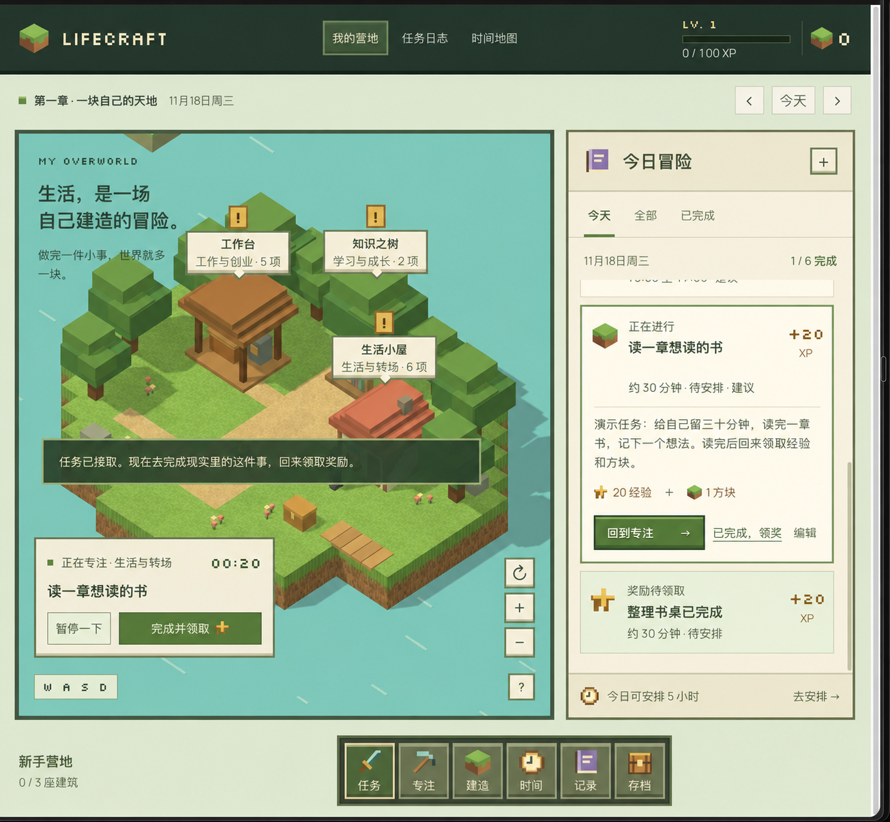

# Lifecraft Quests

Complete real tasks. Earn blocks. Build a little world of your own.

[Play the demo](https://paipeline.github.io/lifecraft-quests/) · [Report a bug or suggest a quest](https://github.com/paipeline/lifecraft-quests/issues) · [Contribute](CONTRIBUTING.md)

Lifecraft Quests is an open-source, browser-local task adventure with an original voxel camp. Walk around, pick a quest, run a focus timer, and collect XP and building materials when you finish. Spend materials on a farm, library or beacon, or place grass, wood and stone blocks yourself.

The current interface is in Chinese. The calendar, focus timer and game run entirely in the browser. No signup, task-upload endpoint or analytics are included.



The preview uses fictional tasks, with task text replaced for privacy.

## Run locally

```sh
python3 -m http.server 8080 --directory site
```

Open `http://localhost:8080`. Modern WebGL support is required for the 3D camp; the quest journal and calendar remain available without it.

## Play

- Click the ground or focus the camp and use WASD / arrow keys to move.
- Select a quest and start a focus session. Pause or resume whenever you need.
- Confirm a real task is finished to collect XP and one block. Each task pays once.
- Open the building inventory to unlock a blueprint or enter free building. Click to place a block, right-click to reclaim it, or use the reclaim button on touch devices. Reclaiming returns the material. Stacks are limited to three blocks.
- Opening free building pauses an active focus session. Finishing a task shows a small reward notification instead of interrupting the whole screen.
- The time map shows tasks, deadlines, scheduled time and available time from 09:00 to 19:00 in your browser's time zone.

There are no missed-day penalties or lost streaks.

## Your data

All bundled tasks are fictional demo examples, generated relative to the current day. The public release has separate storage keys, no migration from personal dashboards and no links into a private knowledge base.

Your tasks and game state stay in this browser. Use the save inventory to export a JSON backup and restore it yourself on another device. A static hosting provider will receive ordinary website requests; this app has no API for uploading task content.

## Development

The app is buildless HTML, CSS and JavaScript, with self-hosted Three.js and fonts. `calendar-model.js` owns time rules, `game-model.js` owns rewards and building rules, and `world.js` renders the voxel camp. The scene, textures and game icons are original procedural artwork.

Run the model checks with Node.js:

```sh
node --test test/*.test.cjs
```

The 14 checks cover overlapping schedules, free time, deadlines, backups, demo data, once-only rewards, building costs and block placement/reclaiming. Safari was also checked for first rendering, paused focus, placing a block and reclaiming its material. Touch controls have not been checked on a physical phone.

## License

MIT for the application. Three.js, Phosphor and font licenses are preserved in `site/assets/`. No assets from a commercial game are bundled.
